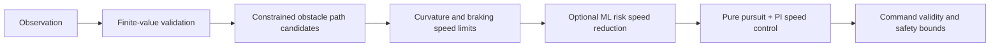

# Reliability-first controller study

## Selection

The submitted controller remains the byte-preserved verified file
`submission/hackbama.py` (SHA-256 prefix `040c6ccd87075680`). It completed the
official five-course selftest with zero penalties and a 65.5/75 mean technical
score. The new controllers are retained as experiments because they did not
improve the common held-out reliability metrics.

## Common held-out evaluation

All variants used the bicycle backend, the same 20 generated courses (`seeds
300–319`), and the same simulator configuration. A penalty is any cone hit,
off-course event, missed gate, or obstacle hit.

| Variant | Finished | Zero-penalty | Mean time (s) | Mean path error (m) | Total penalties |
|---|---:|---:|---:|---:|---:|
| Preserved verified controller | 20/20 | 17/20 | 42.78 | 0.190 | 5 |
| Deterministic hybrid planner | 20/20 | 15/20 | 46.79 | 0.195 | 22 |
| Hybrid planner + ML risk gate | 20/20 | 15/20 | 48.47 | 0.200 | 22 |

Raw per-course results are in `experiments/heldout_variant_results.json`.
The verified submission speed traces are plotted in
`experiments/verified_telemetry.png`.

## ML experiment

Training used 12 generated courses with four perturbation scenarios (nominal,
low grip, actuator delay, and combined), grouped by course so validation
courses were unseen during fitting. The model is a 10-feature regularized
logistic classifier with 11 parameters and NumPy-only inference. It predicts a
near-future risk event from speed, rear slip, lateral and heading error,
curvature demand, lateral acceleration use, boundary margin, obstacle
proximity, delay, and yaw residual. It can only lower the speed target; path
feasibility and command validity remain deterministic safety decisions.

The model was trained on 55,596 observations and validated on 16,917
observations from three held-out course groups. Validation recall was 0.655,
precision 0.224, and Brier score 0.0560. The exact parameters are in
`experiments/risk_model.json`; training output is in
`experiments/risk_training_output.json`.

Because the ML gate increased mean time and did not reduce penalties on the
20-course comparison, it is not enabled in the submission. This is a measured
selection decision, not a claim of ML improvement.

## Architecture

## Verification

`tests/test_hackbama_hybrid.py` covers malformed previews, NaN risk inputs,
opposite obstacle feasibility, bounded paths, and mutually exclusive pedals.
The repository suite passed (`59 passed`), and the official selftest of the
preserved submission passed all five public courses with no controller errors
or computation deadline violations. CARLA was not installed; all results use
the official bicycle backend.

## Judge Q&A

**Why not use a neural network?** The runtime guarantees NumPy only and a
50 ms deadline. The grouped linear model is auditable, tiny, and safe to
disable; the measured held-out result did not justify enabling it.

**How is an obstacle bypass selected?** Candidate left and right offsets are
checked against the visible corridor and vehicle clearance. The shortest
feasible side is smoothed over the preview; same-side obstacles share the
largest required offset.

**How do you avoid unrealistic commands?** Steering, throttle, and brake are
finite and bounded. Brake distance is checked over preview curvature, throttle
is reduced near the lateral grip limit, and throttle and brake cannot overlap.

**What remains difficult?** A 20% friction reduction on the tight loop still
causes boundary contacts for the selected nominal-speed tuning. That failure is
reported explicitly; a more conservative tuning cleared it but scored lower on
the official nominal courses.
